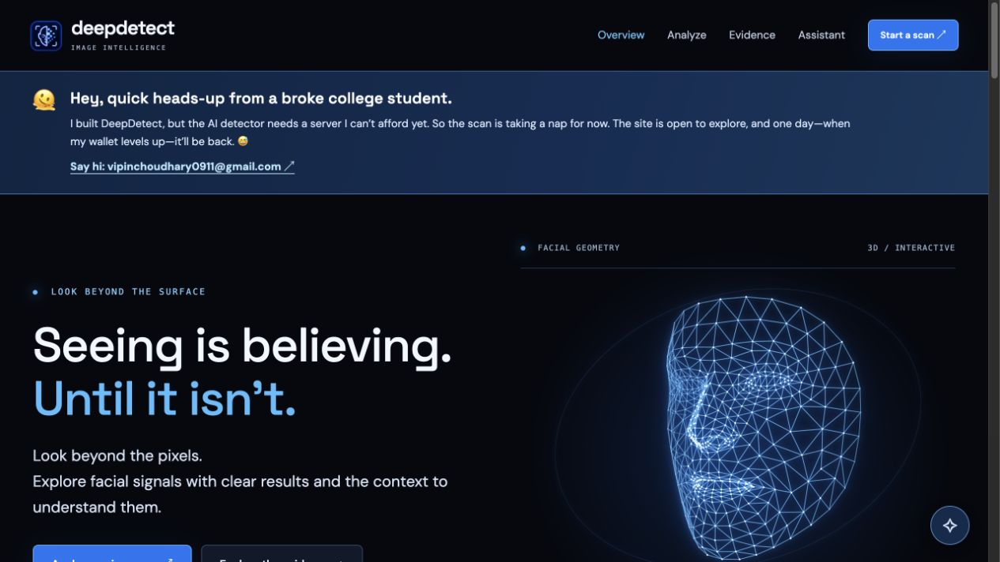
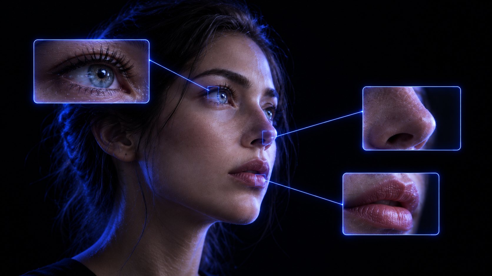

# DeepDetect — look beyond the surface

**An image-verification experience with a little more context and a lot less guesswork.**

Explore facial manipulation clues, learn how to question a suspicious image, and ask an AI assistant for guidance. Built by **Vipin Choudhary**.

[Explore the site](#what-you-can-explore) · [Current status](#current-status) · [Deploy on Vercel](#deploy-on-vercel) · [How the assistant works](#how-the-assistant-works)



## Current status

> **The public image detector is paused.** The original model needs a server with more memory and compute than I can afford to host right now. The Vercel site is a public preview: the design, educational pages, interactive face, and optional Gemini assistant are available, but it **does not analyze uploaded images**. The banner on every page says this plainly.

The assistant can work without a separate Render server because a small Vercel Function calls Gemini. It answers questions about image verification; it cannot see or verify an image. A Gemini API key and available quota are required for it to reply.

## What you can explore

| Area | What it offers | Status |
| --- | --- | --- |
| Overview | Responsive landing page, rotating 3D facial mesh, illustrated facial regions, practical verification steps, and a clear scan status | Available |
| Evidence | An illustrated comparison, explanations of scores and false positives, and limits of visual inspection | Available |
| Assistant | Text-based guidance on scores, source checks, and common pitfalls | Available after Gemini setup |
| AI & privacy | What the public preview sends to Gemini and how to interpret AI output | Available |
| Image scanning | Classification of uploaded images or folders | Paused in this public deployment |

The animated facial mesh is an **illustration**, not a live detection visualization. Highlighted eyes, nose, and lips are prompts for human inspection, not claims that the model found manipulation in those areas.

<p align="center">
  
</p>

## Deploy on Vercel

This repository is ready to import from GitHub. The project contains static pages in `public/` and one serverless function in `api/chat.js`. **No Python, model download, Render service, or build step is required for this preview.**

On Vercel's **New Project** screen, select `VipinChoudhary-dev/DeepDetect-Deepfake-Detection` on the `main` branch and use:

| Vercel field | Enter or select |
| --- | --- |
| Vercel Team | Your Hobby team is fine |
| Project Name | `DeepDetect-Deepfake-Detection` is fine; Vercel may make the URL lowercase |
| Root Directory | `./` |
| Application Preset | **Other** |
| Build Command | Leave blank |
| Output Directory | `public` |
| Install Command | Leave blank |

Under **Environment Variables**, add:

| Key | Value | Where |
| --- | --- | --- |
| `GEMINI_API_KEY` | Your **new, private** Gemini API key | Production and Preview, if you want chat in both |
| `GEMINI_MODEL` | Optional model ID available to your key; the code defaults to `gemini-3.5-flash-lite` | Same environments as the key |

Then click **Deploy**. If you do not have a key ready, deploy without it; the pages will still load, but assistant messages will report that it is not configured. You can add the key later under **Project → Settings → Environment Variables** and redeploy from **Deployments**.

**Keep the key in Vercel's Environment Variables.** Do not add it to GitHub files or browser JavaScript. A key pasted into a chat or shared elsewhere should be rotated before public deployment. Gemini usage depends on the quota and billing settings of your Google account.

When deployment finishes, open the Vercel URL and check these paths:

1. `/` — homepage and the visible detector status banner.
2. `/evidence/` — evidence and limitations.
3. `/assistant/` — ask a simple text question if the key is configured.
4. `/privacy/` — AI and privacy information.

If the site works but the assistant does not, check that `GEMINI_API_KEY` was added to the same environment as the deployment, redeploy after adding it, and confirm the selected Gemini model is available to your key. The assistant can also be limited by provider quota.

## How the assistant works

```text
Visitor's browser → /api/chat → Vercel Function → Google Gemini
                                     ↑
                          GEMINI_API_KEY in Vercel
```

The browser sends only the question typed into the assistant. The function validates it, applies basic per-instance throttling, and forwards it to Gemini. It does not receive uploaded images or scan scores. The key stays on the server side. The assistant's answer may be wrong; it is guidance for checking claims, not a verdict on authenticity.

## Run the preview locally

From the repository root:

```bash
python3 -m http.server 8765 --directory public
```

Open `http://127.0.0.1:8765/`. This previews the static pages and animation. Python's simple server does **not** run the Vercel Function, so the assistant needs a Vercel deployment (or a compatible local Vercel runtime) to answer.

## Repository map

```text
.
├── api/
│   └── chat.js                 # Server-side Gemini proxy
├── docs/assets/
│   └── home.jpg                # README screenshot
├── public/
│   ├── index.html              # Homepage
│   ├── assistant/index.html    # Assistant page
│   ├── evidence/index.html     # Evidence page
│   ├── privacy/index.html      # Privacy page
│   └── static/detector/        # Styles, scripts, mesh data, images
├── .env.example                # Example model setting, no secrets
└── vercel.json                 # Static output configuration
```

This deployable package intentionally excludes model weights, datasets, local paths, and private keys. The research detector is separate from this public preview.

## Interpreting image evidence

Deepfake detection is uncertain. Compression, low resolution, filters, lighting, and small or obscured faces can change the clues available. A score from a detector is a model output, **not proof** that a person or image is fake. Check the earliest source you can find, compare independent context, and avoid drawing a consequential conclusion from one automated result.

## Credits

Designed and built by **Vipin Choudhary**. The facial mesh illustration uses [Google MediaPipe's canonical face geometry](https://github.com/google-ai-edge/mediapipe) under its Apache 2.0 license. The site is for research and education.
